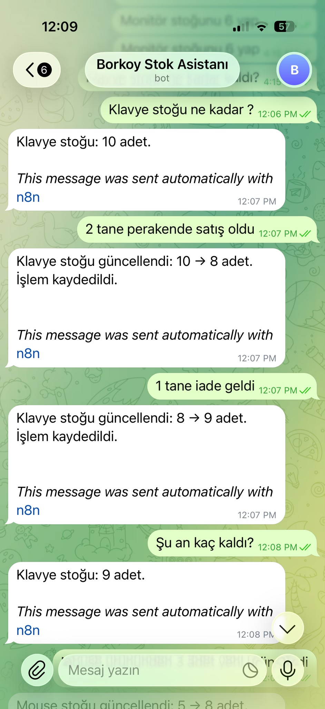
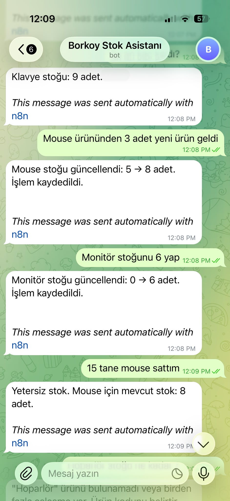
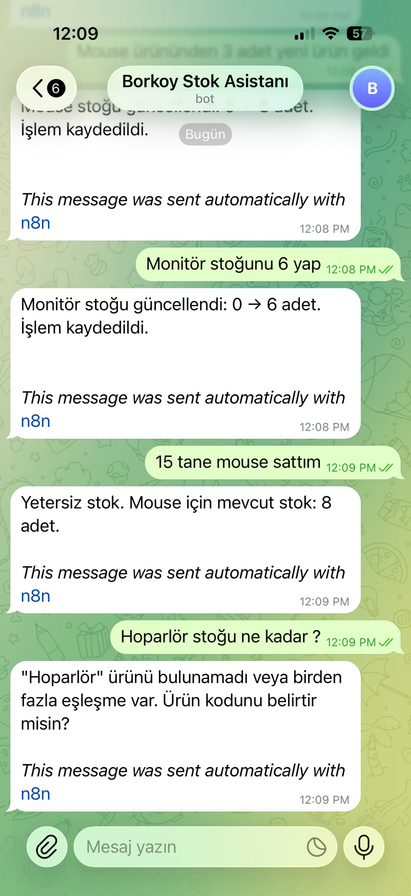
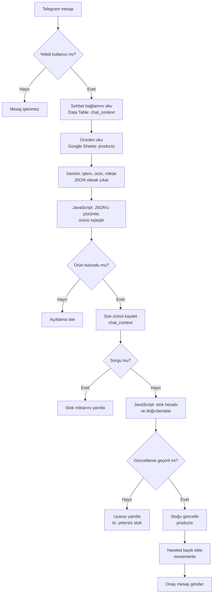

# Mini ERP · Telegram Stok Asistanı

Telegram üzerinden doğal Türkçe mesajlarla temel stok işlemlerinin yapılmasını sağlayan bir **n8n iş akışı prototipi**.
“2 klavye sattım” veya “Mouse ürününden 3 adet geldi” gibi mesajları anlayarak stoğu Google Sheets üzerinde günceller
ve her değişikliği bir hareket kaydı olarak saklar.

> Bu proje, temel stok işlemlerine odaklanan bir **prototiptir**. Gerçek müşterilerde kullanılmamıştır ve kapsamlı,
> üretime hazır bir ERP sistemi değildir.

## Demo

| Sorgu, satış, iade ve devam sorusu | Ürün girişi, stok ayarlama, yetersiz stok | Bulunamayan ürün |
|---|---|---|
|  |  |  |

İlk ekran görüntüsünde “2 tane perakende satış oldu” mesajında ürün adı geçmiyor; asistan sohbetteki son ürünü (Klavye)
hatırlayarak işlemi yapıyor.

## Amaç ve hedef kitle

Küçük işletmeler ve stok takibini tablolar üzerinden yapan kullanıcılar, her satışta veya ürün girişinde tabloyu açıp
elle düzenlemek zorunda kalır. Bu prototip, aynı işlemleri telefondan tek bir mesajla yapmayı amaçlar:

- Stok takibini Google Sheets üzerinde yapan küçük işletmeler
- Mağaza veya depoda stok hareketlerini anında kaydetmek isteyen kullanıcılar
- n8n ve yapay zekâ destekli otomasyonları öğrenmek isteyenler

## Özellikler

- **Stok sorgulama:** “Klavye stoğu ne kadar?”
- **Satış:** Satılan miktarı stoktan düşer.
- **İade ve yeni ürün girişi:** Gelen miktarı stoğa ekler.
- **Stok ayarlama:** Stoğu doğrudan belirtilen miktara ayarlar (“Monitör stoğunu 6 yap”).
- **Doğrulama:** Yetersiz stokta ve geçersiz miktarda (negatif, ondalıklı, satış/iade/girişte sıfır) güncelleme yapmaz.
- **Açıklama isteme:** Ürün bulunamazsa veya birden fazla ürün eşleşirse kullanıcıdan netleştirme ister.
- **Sohbet bağlamı:** Sohbette son işlem yapılan ürünü hatırlar; “Şu an kaç kaldı?” gibi devam sorularını yanıtlar.
- **Kayıt:** Stok değişikliğini `products` tablosunda günceller ve `movements` tablosuna hareket kaydı ekler.
- **Yetkili kullanıcı kontrolü:** Yalnızca tanımlı Telegram kullanıcı ID'sinden gelen mesajları işler.

## Kullanılan teknolojiler

| Teknoloji | Görevi |
|---|---|
| **n8n** | İş akışının tamamı: tetikleyici, koşullar, kod adımları, entegrasyonlar |
| **Telegram Bot API** | Mesajların alınması ve yanıtların gönderilmesi |
| **Google Gemini** | Mesajdan işlem türünü, ürün adını ve miktarı JSON olarak çıkarma |
| **JavaScript (n8n Code düğümü)** | Ürün eşleştirme, stok hesabı ve miktar doğrulamaları |
| **Google Sheets** | Ürün ve stok tablosu (`products`), hareket kayıtları (`movements`) |
| **n8n Data Tables** | Sohbet bağlamı: her sohbetin son ürünü (`chat_context`) |

**Görev ayrımı bilinçli olarak yapılmıştır:** Gemini yalnızca mesajı yorumlar; stok hesabı ve doğrulamalar deterministik
JavaScript koduyla yapılır. Böylece yapay zekâ bir stok miktarını “uyduramaz” veya hesap hatası yapamaz. Prompt'ta da
modelden ürün veya miktar uydurmaması ve stok hesabı yapmaması açıkça istenir.

## Çalışma akışı



Gemini'nin desteklediği işlem türleri: `query` (sorgu), `sale` (satış), `return` (iade), `receipt` (yeni ürün girişi),
`set` (stok ayarlama) ve `unknown` (anlaşılamayan mesaj).

## Veri yapısı

**Google Sheets · `products` sekmesi**

| sku | product_name | stock |
|---|---|---|
| KLV-001 | Klavye | 10 |
| MOU-001 | Mouse | 5 |

**Google Sheets · `movements` sekmesi** (başlık satırı)

| operation | sku | quantity | before | after | status | source_text |
|---|---|---|---|---|---|---|

**n8n Data Table · `chat_context`**: `chat_id` (metin) ve `last_sku` (metin) sütunları.

Tablodaki örnek SKU değerleri yalnızca örnektir; kendi ürün kodlarınızı kullanabilirsiniz.

## Kurulum

1. **Telegram botu oluşturun:** Telegram'da [@BotFather](https://t.me/BotFather) ile yeni bir bot oluşturup bot
   token'ını alın.
2. **Telegram kullanıcı ID'nizi öğrenin:** Örneğin [@userinfobot](https://t.me/userinfobot) size kullanıcı ID'nizi
   gönderir.
3. **Google Sheets tablosunu hazırlayın:** Yeni bir tablo oluşturun ve yukarıdaki sütun başlıklarıyla `products` ve
   `movements` adlı iki sekme ekleyin. `products` sekmesine ürünlerinizi girin.
4. **Gemini API anahtarı alın:** [Google AI Studio](https://aistudio.google.com/) üzerinden bir API anahtarı oluşturun.
5. **Data Table oluşturun:** n8n'de `chat_id` ve `last_sku` metin sütunlarına sahip `chat_context` adlı bir Data Table
   oluşturun. Data Tables, n8n'in güncel sürümlerinde bulunan bir özelliktir.
6. **İş akışını içe aktarın:** n8n'de *Import from File* ile
   [`workflow/mini-erp-telegram-stok-asistani.json`](workflow/mini-erp-telegram-stok-asistani.json) dosyasını içe aktarın.
7. **Kimlik bilgilerini tanımlayın:** Telegram düğümlerinde bot token'ınızla bir Telegram credential'ı, Google Sheets
   düğümlerinde Google hesabınızla bir credential, *Google Gemini Chat Model* düğümünde Gemini API anahtarınızla bir
   credential seçin veya oluşturun.
8. **Kaynakları bağlayın:** Üç Google Sheets düğümünde (*Get row(s) in sheet*, *Update row in sheet*,
   *Append row in sheet*) kendi tablonuzu ve ilgili sekmeyi; iki Data Table düğümünde (*Hafızayı Oku*,
   *Hafızaya yaz*) `chat_context` tablosunu seçin. Paylaşılan dosyada bu alanlar `YOUR_GOOGLE_SHEET_ID` ve
   `YOUR_DATA_TABLE_ID` yer tutucularını içerir.
9. **Yetkili kullanıcıyı tanımlayın:** *If* düğümündeki koşulda `0` değerini kendi Telegram kullanıcı ID'nizle
   değiştirin. Bu değer değiştirilmeden bot hiçbir mesaja yanıt vermez; yetki kontrolü bilerek kapalı değil,
   “kimseye izin verme” durumunda paylaşılmıştır.
10. **İş akışını etkinleştirin** ve botunuza mesaj gönderin.

> Paylaşılan dosyada kişisel Telegram kullanıcı ID'si, Google Sheets bağlantıları, credential referansları ve n8n
> kurulum tanımlayıcıları yoktur. Bot token'ı ve API anahtarları yalnızca kendi n8n kimlik bilgilerinizde saklanmalıdır.

## Örnek kullanım

| Mesaj | Asistanın yanıtı (örnek) |
|---|---|
| Klavye stoğu ne kadar? | Klavye stoğu: 10 adet. |
| 2 klavye sattım. | Klavye stoğu güncellendi: 10 → 8 adet. İşlem kaydedildi. |
| 1 tane iade geldi. | Klavye stoğu güncellendi: 8 → 9 adet. İşlem kaydedildi. |
| Şu an kaç kaldı? | Klavye stoğu: 9 adet. |
| Mouse ürününden 3 adet yeni ürün geldi. | Mouse stoğu güncellendi: 5 → 8 adet. İşlem kaydedildi. |
| Monitör stoğunu 6 yap. | Monitör stoğu güncellendi: 0 → 6 adet. İşlem kaydedildi. |
| 15 tane mouse sattım. | Yetersiz stok. Mouse için mevcut stok: 8 adet. |
| Hoparlör stoğu ne kadar? | "Hoparlör" ürünü bulunamadı veya birden fazla eşleşme var. Ürün kodunu belirtir misin? |

## Sınırlamalar

- **Tek yetkili kullanıcı:** Yetki kontrolü tek bir Telegram kullanıcı ID'sine göre yapılır. Yetkisiz kullanıcıların
  mesajları yanıtsız bırakılır.
- **Tam eşleşme:** Ürünler, ürün adı veya SKU ile büyük/küçük harf duyarsız **tam eşleşmeyle** bulunur; yazım
  hatalarını veya benzer adları tanımaz.
- **Mesaj başına tek işlem:** Bir mesajda yalnızca bir ürün ve bir işlem işlenir.
- **Tam sayı miktarlar:** Ondalıklı miktarlar desteklenmez.
- **Sınırlı hareket kaydı:** Hareket kaydında tarih-saat ve işlemi yapan kullanıcı bilgisi tutulmaz.
- **İşlem bütünlüğü:** Stok güncellemesi ve hareket kaydı iki ayrı adımdır; aradaki bir hatada ikisi tutarsız
  kalabilir. Aynı anda gelen birden fazla mesaj için kilitleme yoktur.
- **Yapay zekâ bağımlılığı:** Mesajın yorumlanması Gemini'ye bağlıdır. Model geçerli JSON döndürmezse asistan mesajın
  tekrar yazılmasını ister.
- **Prototip:** Raporlama, kullanıcı yönetimi, çoklu depo veya muhasebe gibi ERP işlevleri kapsam dışıdır.

## Proje yapısı

```text
workflow/mini-erp-telegram-stok-asistani.json   n8n iş akışı 
docs/                                           Demo ekran görüntüleri
README.md
```
